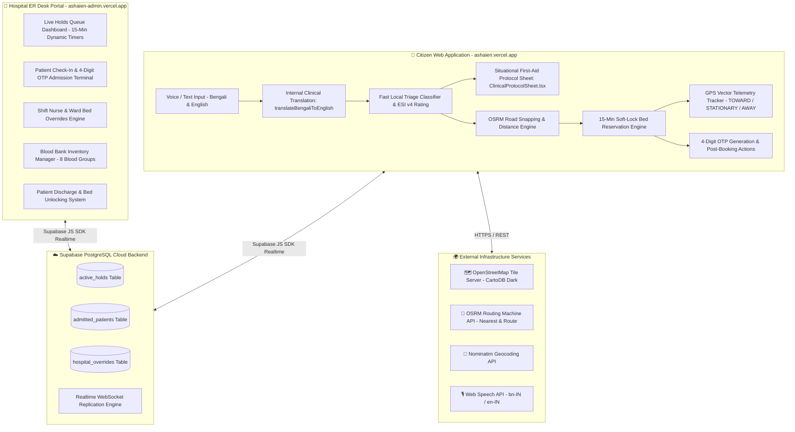
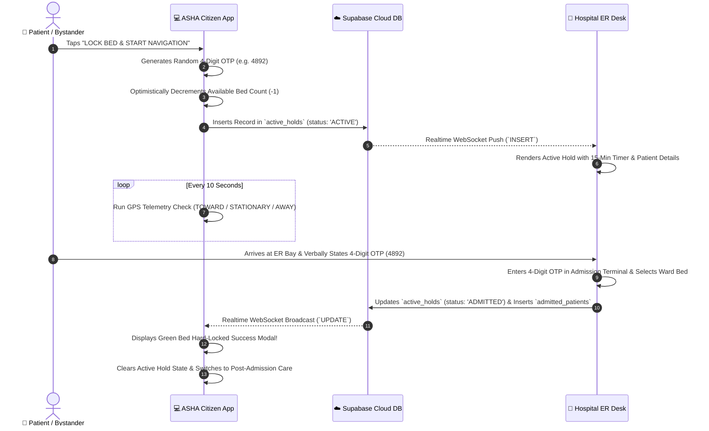

# 🌐 Document 1: Master Architecture & Core Tech Stack Blueprint

Welcome to the **ASHA (Automated System for Hospital Allocation)** Master Architecture Blueprint. This document provides an exhaustive, highly technical, and all-inclusive breakdown of how the entire ASHA ecosystem operates, how its frontend and backend components communicate, how real-time cloud database channels synchronize data, and how the underlying algorithms power real-time emergency healthcare triage, routing, and en-route stabilization.

---

## 🏆 Official SIH 2026 Team & Project Identification

- **Team Name:** `TEAM ASHA`
- **Team Leader:** `SHAYAK DAS`
- **Category:** `Student Innovation (Open Category — Theme: MedTech / BioTech / HealthTech)`
- **Problem Statement Title:** `Mitigating Emergency Golden-Hour Fatalities Caused by In-Transit Bed Allocation Latency and Static Hospital Resource Visibility`
- **Primary Technical Breakthrough:** Live Situational First-Aid & En-Route Action Protocols + Bengali Speech-to-Clinical Translation + 15-Minute Dynamic GPS Soft-Lock Bed Reservation with 4-Digit OTP Admission.

---

## 🚀 1. System Vision & Executive Problem Statement

During medical emergencies (the "Golden Hour"), critical delays occur not because ambulances are unavailable, but because **patients wander between hospitals that lack available beds or staffed medical personnel**. Standard mapping platforms (like Google Maps) only display static hospital locations without real-time bed or blood availability. Government dashboards often suffer from the **"Ghost Bed" Phenomenon**—displaying physical furniture without active on-duty nurses or oxygen points.

Furthermore, during the 30–45 minute transit period to the hospital, bystanders and families panic, frequently committing fatal layman errors (such as pouring water down an unconscious person's throat or letting an acute coronary syndrome patient walk).

ASHA bridges this critical emergency gap by creating an integrated, real-time emergency triage grid connecting **Citizens (Patients/Bystanders)** with **Hospital Emergency Room Desks** via:
1. **Multilingual Speech & Natural Language Triage Engine (Bengali Script & English)** with internal clinical translation.
2. **Live Situational First-Aid & En-Route Action Protocols (OUR BIGGEST PLUS POINT)**: Immediate posture (Semi-Fowler 45°, Recovery position), 10-second ABC assessment, step-by-step life support, and critical DO NOT DO warnings.
3. **OSRM Road Snapping & Drivable Routing Engine** (<420ms route generation with urban traffic calibration).
4. **15-Minute GPS Vector Telemetry Soft-Lock Bed Reservation System** with anti-hoarding directional tracking.
5. **Direct 4-Digit OTP Entrance Verification** (replacing fragile optical QR scanning at the ER bay).
6. **Dual-App Real-Time Cloud Sync (Supabase WebSockets + BroadcastChannel)**.
7. **Staffed Bed Capacity Calculator (Nurse-to-Patient Ratio Engine)**.

---

## 🏗️ 2. High-Level Architecture Topology & System Interaction Diagram

ASHA is composed of two primary web applications communicating through a central cloud database and real-time WebSocket channels:



---

## 🛠️ 3. Complete Technology Stack & Architectural Specifications

| Component Layer | Technology Choice | Architectural Justification & Technical Role |
| :--- | :--- | :--- |
| **Frontend Framework** | **React 18 + TypeScript + Vite 6** | Fast component rendering, strong type safety, zero-lag UI updates during high-frequency GPS telemetry loops. |
| **Styling & Aesthetics** | **Vanilla CSS + Tailwind CSS + Lucide Icons** | Custom Liquid Glassmorphism design system (`backdrop-filter: blur(20px)`), Tiranga Saffron/Green theme tokens, high-contrast dark mode. |
| **Mapping & Canvas** | **Leaflet.js + OpenStreetMap (OSM)** | Lightweight interactive vector map rendering without Google Maps API cost barriers or per-query rate limits. |
| **Routing Engine** | **OSRM (Open Source Routing Machine) API** | High-performance C++ routing engine providing map snapping (`nearest/v1/driving`) and drivable geometry (`route/v1/driving`). |
| **Address Geocoding** | **OSM Nominatim API** | Reverse geocoding of GPS coordinates and debounced search autocomplete. |
| **Voice Speech Input** | **Web Speech API (`webkitSpeechRecognition`)** | Built-in browser speech recognition tuned for English (`en-IN`) and Bengali (`bn-IN`). (Hindi/Hinglish removed to eliminate acoustic confusion). |
| **Translation Engine** | **Internal `translateBengaliToEnglish()`** | Deterministic in-memory translation converting native Bengali script (`বুকে ব্যথা`) into clinical English keywords (`acute chest pain heart attack cardiac angina buke betha`). Zero cloud latency, zero API costs. |
| **Cloud Database & WebSockets** | **Supabase (PostgreSQL + Realtime Channel)** | Enterprise-grade cloud backend storing active holds, admission logs, and real-time hospital overrides. |
| **Local Inter-Tab Sync** | **HTML5 BroadcastChannel API** | Zero-latency cross-tab event synchronization when Citizen and Admin apps run on the same physical browser instance. |
| **Gate Verification** | **Spoken / Keyed 4-Digit Numeric OTP** | Fast, high-reliability ER entrance check-in that works in the dark, on broken screens, or via paramedic voice dispatch without optical camera scanners. |
| **Hosting & CI/CD** | **Vercel Cloud Infrastructure** | Automated production deployments with SSL edge caching and instant serverless distribution. |

---

## 🗄️ 4. Baseline Hospital Dataset Construction & Structure

The baseline hospital database (`v2/src/data/hospitals.ts`) was constructed using real geographic coordinates, street addresses, and emergency capacities across major medical centers in Kolkata.

### A. Geographic Corridors Covered:
1. **New Town / Action Area II Corridor:** Tata Medical Center, Ohio Hospital, Newtown ER, Bhagirathi Neotia, HCG EKO Cancer Centre, Glocal Hospital.
2. **Dum Dum / Nagerbazar Corridor:** ILS Hospital Nagerbazar, Apex General Hospital, Spandan Hospital, Dum Dum Municipal Hospital, Charnock Hospital, RG Kar Medical College, Matri Sadan Hospital.
3. **Salt Lake Sector V IT Hub Corridor:** AMRI Salt Lake, Columbia Asia / Manipal Hospital.
4. **EM Bypass / Central Kolkata Corridor:** Apollo Gleneagles, Ruby General Hospital, Fortis Healthcare, SSKM (IPGMER) Hospital.

### B. Hospital Data Schema & Ward Breakdown:
Each hospital record tracks 4 distinct specialized wards:
- `general_oxygen` / `general_ward`: General ward equipped with high-flow oxygen lines.
- `cardiac_icu`: Cardiac Intensive Care Unit / Coronary Care Unit (CCU).
- `adult_icu`: Adult Intensive Care Unit.
- `pediatric_icu`: Pediatric Intensive Care Unit (PICU).

```typescript
export interface Hospital {
  id: string;
  name: string;
  short_name: string;
  lat: number;
  lng: number;
  phone: string;
  is_govt: boolean;
  total_beds: number;
  available_beds: number;
  occupied_beds: number;
  held_beds: number;
  on_duty_nurses: number;
  is_trauma_center: boolean;
  has_blood_bank: boolean;
  has_cath_lab: boolean;
  has_pediatric_icu: boolean;
  distance_km: number;
  eta_minutes: number;
  wards: WardCapacity[];
  blood_summary: BloodStockSummary[];
}
```

---

## 🧠 5. Multilingual Natural Language Triage & Bengali Translation

The core of ASHA's emergency detection is a **Fast Local Clinical Classifier** (`triageClassifier.ts` & `aiTriageService.ts`). It translates natural spoken or typed phrases in **Bengali (বাংলা হরফ & Roman script)** and **English** into standardized medical emergency categories without relying on slow external cloud LLMs.

### A. Why Internal Bengali Translation Was Built (`translateBengaliToEnglish`):
- **The Problem:** The browser's native Web Speech API transcribes Bengali voice into native Unicode Bengali script (e.g., `বুকে ব্যথা`, `শ্বাসকষ্ট`, `রক্তক্ষরণ`). However, clinical emergency rules, Emergency Severity Index (ESI) standards, and hospital ward codes are defined in standardized English (`cardiac_icu`, `acute coronary syndrome`, `STEMI`). Without translation, raw Bengali inputs fail downstream matching and fall back to low-acuity general wards.
- **The Solution:** A high-speed internal translation engine intercepts Bengali script and maps it directly into canonical English clinical terms (`acute chest pain heart attack cardiac angina buke betha`).
- **Clinical Rationale:** This provides **instant zero-latency translation with 0 API costs, 0 external cloud failure points, and complete offline resilience**, allowing a patient speaking Bengali to receive identical triage accuracy to an English speaker.

### B. Emergency Severity Index (ESI v4) Assignment:
- **ESI-1 (RED):** Cardiac Arrest, Unresponsive, Severe STEMI Chest Pain (`বুকে ব্যথা` / `buke betha`), Stroke (`মুখ বেঁকে যাওয়া` / `mukhe baka`), Arterial Bleeding (`পা থেকে রক্ত পড়ছে` / `paaye theke rokto`). Assigned to `cardiac_icu` or `adult_icu`.
- **ESI-2 (YELLOW):** High Fever, Fractures, Acute Leg Pain/DVT (`পায়ে ব্যথা` / `paaye betha`), Asthma (`শ্বাসকষ্ট` / `sash nite koshto`). Assigned to `general_oxygen` or `pediatric_icu`.
- **ESI-3 (GREEN/YELLOW):** General queries like *"nearest hospital"*, *"doctor"*, or *"emergency"*. **Strictly assigned to `general_oxygen` (General Ward)**.

---

## 🌟 6. OUR BIGGEST PLUS POINT: Live Situational First-Aid Protocols

### Why This Is Done (The En-Route Survival Crisis):
In India, more than 50% of acute myocardial infarction and severe trauma fatalities occur before the patient ever reaches the emergency department. During the 30–45 minute transit window, family members and bystanders panic:
- They force water or aspirin into an unconscious person's mouth, causing fatal pulmonary aspiration asphyxiation.
- They let a suspected STEMI heart attack patient walk or lie completely flat, causing acute pulmonary congestion.
- They repeatedly lift wound dressings, disrupting platelet clots and accelerating exsanguination.

### How ASHA Solves It (`ClinicalProtocolSheet.tsx`):
The instant a symptom is triaged, ASHA renders actionable, real-time medical instructions directly on the screen:
1. **Immediate Ergonomic Posture:** Semi-Fowler 45° elevation with bent knees for chest pain; Recovery Position on left side for unconscious/stroke victims; Direct continuous pressure with tourniquet for arterial bleeding.
2. **10-Second Rapid ABC Assessment:** Airway, Breathing, and Circulation check.
3. **Step-by-Step Tactical Actions:** Numbered life-support guidance to perform en route.
4. **CRITICAL DO NOT DO Warnings:** Clear, bold prohibitions against fatal layman blunders.
5. **Bystander Calming Script:** High-empathy stabilization phrases to keep bystanders calm and focused.

---

## 🔒 7. Bed Reservation Lifecycle: Soft-Lock vs. Hard-Lock



### Phase A: 15-Minute Soft-Lock Reservation
- Tapping **"LOCK BED & START NAVIGATION"** reserves 1 hospital bed for 15 minutes (900 seconds).
- Generates a unique, secure 4-digit numeric verification OTP (`4892`).
- Decrements available bed count live across local UI state and cloud storage.

### Phase B: GPS Vector Telemetry Tracking
- While traveling, the app samples device GPS movement every 10 seconds.
- **TOWARD (Approaching):** Distance is decreasing; 15-minute countdown is paused, and a live dynamic ETA is displayed.
- **STATIONARY (Not Moving):** 15-minute countdown decrements every second.
- **AWAY (Moving in Wrong Direction):** Prompts a Wrong Direction Alert. If uncorrected over consecutive samples, auto-cancels the hold and restores the bed to the public pool to prevent hoarding.

### Phase C: Gate OTP Check-In & Hard-Lock Admission (Why OTP Over QR)
- **Why QR Codes Were Eliminated:** In an emergency bay, ambulances arrive in high tension, rain, or darkness. Patient screens are often cracked, wet, or low on battery. Optical barcode scanners struggle with screen glare and physical distance.
- **Why 4-Digit OTP is Superior:** A 4-digit number can be spoken aloud across the desk by a paramedic or bystander in under 2 seconds, keyed into the nurse's terminal without leaving her seat, or transmitted over telephone dispatch.
- **Hard-Lock Execution:** The triage nurse inputs the 4-digit OTP. The cloud status updates to `'ADMITTED'`, the bed is permanently deducted, and the patient's phone displays the Hard-Locked Admission confirmation.

---

## ⚡ 8. Real-Time Data Flow Payload Specifications

### A. OSRM Nearest API Sample Payload (`/nearest/v1/driving`):
```json
{
  "code": "Ok",
  "waypoints": [
    {
      "hint": "a_I1gP___38AAAAAEAAA...",
      "distance": 4.12,
      "name": "Major Arterial Road, Newtown",
      "location": [88.475612, 22.585234]
    }
  ]
}
```

### B. Supabase WebSocket Hold Insertion Payload (`active_holds`):
```json
{
  "event": "INSERT",
  "schema": "public",
  "table": "active_holds",
  "new": {
    "hold_id": "hold_1789140826192_tn1n",
    "hospital_id": "hosp-tmc-newtown",
    "otp": "4892",
    "patient_name": "Emergency Patient",
    "symptom": "Acute Chest Pain (buke betha)",
    "ward_code": "cardiac_icu",
    "locked_at": "2026-09-11T15:33:46.192Z",
    "expires_at": "2026-09-11T15:48:46.192Z",
    "status": "ACTIVE",
    "vector_status": "TOWARD"
  }
}
```

---

## 🚀 9. Live Production Deployment Endpoints

- **Citizen Resuscitation Web App:** [https://ashaien.vercel.app](https://ashaien.vercel.app)
- **Hospital ER Command Desk Portal:** [https://ashaien-admin.vercel.app](https://ashaien-admin.vercel.app)
