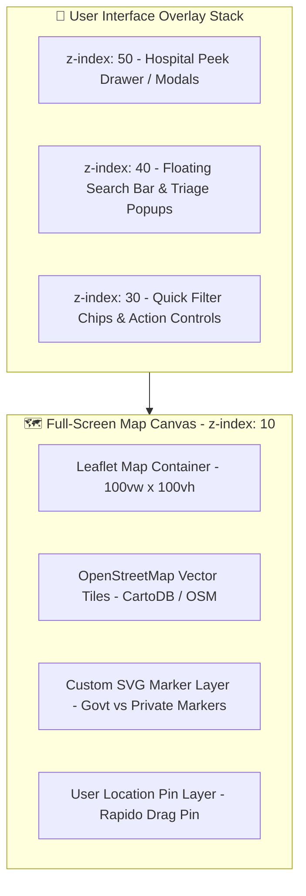
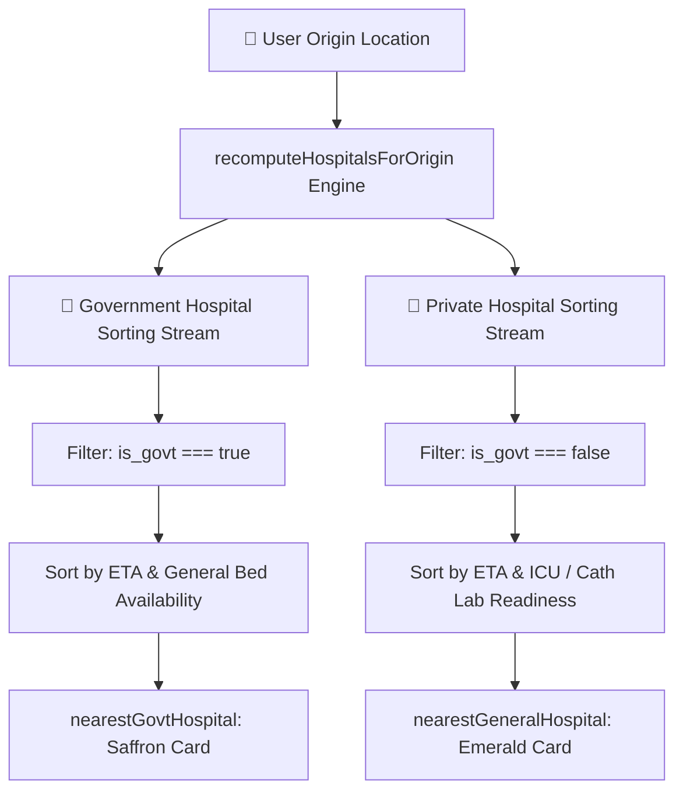

# 🗺️ Document 3: Map Canvas, OSRM Road Snapping & Geospatial Routing Engine

This document presents a deep technical specification of ASHA's **Geospatial Mapping Infrastructure**, **OSRM Road Snapping Engine**, **Haversine Distance Mathematics**, and **Dual-Queue Proximity Sorting Algorithms**.

---

## 📍 1. Leaflet.js & OpenStreetMap Canvas Architecture

ASHA features a full-screen, high-performance interactive map canvas built using **Leaflet.js** and **OpenStreetMap (OSM) tile servers**.



### Technical Design Specifications:
- **Canvas Dimensions:** Full-screen viewport scaling (`100vw` width by `100vh` height) configured as a fixed background element (`position: fixed`).
- **Tile Provider:** OpenStreetMap standard vector tiles layered with CartoDB Dark Matter tiles (`https://{s}.basemaps.cartocdn.com/dark_all/{z}/{x}/{y}{r}.png`) for seamless dark-mode integration.
- **Marker Layering & SVG Customization:**
  - **Government Hospitals:** Custom Saffron SVG building pins (`#FF671F`) with pulse rings.
  - **Private Hospitals:** Custom Emerald Green SVG navigation pins (`#16A34A`) with glowing drop shadows.
  - **Active User Location:** Pulsing cyan radar pin (`#06B6D4`) with accuracy radii rings.

---

## 🛣️ 2. OSRM Road Snapping API Mechanics (Rapido-Style Dragging)

### The Problem: Urban GPS Multipath Signal Drift
In dense urban environments (such as Kolkata's Nagerbazar, Sector V, or Dum Dum), raw smartphone GPS fixes frequently suffer from **multipath signal reflection off high-rise buildings**, placing the user 20 to 50 meters off-road inside buildings, water bodies, or pedestrian walkways. Passing raw GPS coordinates directly into routing algorithms produces broken navigation paths and inaccurate ETAs.

### The Solution: OSRM Perpendicular Road Projection
ASHA implements the **Open Source Routing Machine (OSRM) Nearest API** (`nearest/v1/driving`). When a user moves their pin or grants location access, ASHA projects the raw coordinate $(lng_{\text{raw}}, lat_{\text{raw}})$ onto the nearest open drivable road segment geometry in the OpenStreetMap road network.

```typescript
// OSRM Road Snapping Implementation in App.tsx
async function snapToNearestRoad(lat: number, lng: number): Promise<{ lat: number; lng: number }> {
  try {
    const response = await fetch(
      `https://router.project-osrm.org/nearest/v1/driving/${lng},${lat}?number=1`
    );
    if (response.ok) {
      const data = await response.json();
      if (data.waypoints && data.waypoints.length > 0) {
        const [snappedLng, snappedLat] = data.waypoints[0].location;
        return { lat: snappedLat, lng: snappedLng };
      }
    }
  } catch (error) {
    console.warn('OSRM road snapping fallback to raw GPS:', error);
  }
  return { lat, lng }; // Fallback to raw GPS if network fails
}
```

---

## 📐 3. Geospatial Distance & Dynamic ETA Mathematics

ASHA uses a **2-stage hybrid distance engine** to sort hospitals instantly while providing accurate drivable ETAs.

### Stage 1: Haversine Great-Circle Trigonometry (Instant 30-Hospital Screening)
To calculate straight-line distance across all 30 Kolkata hospitals in $<2\text{ milliseconds}$, ASHA uses the **Haversine Formula**:

$$a = \sin^2\left(\frac{\Delta \phi}{2}\right) + \cos(\phi_1) \cdot \cos(\phi_2) \cdot \sin^2\left(\frac{\Delta \lambda}{2}\right)$$

$$c = 2 \cdot \arctan2\left(\sqrt{a}, \sqrt{1-a}\right)$$

$$d_{\text{haversine}} = R \cdot c$$

- Where $\phi$ is latitude, $\lambda$ is longitude, and $R = 6371\text{ km}$ (Earth's radius).
- **Code File Location:** `d:\HACKATHON\v2\src\utils\distance.ts`.

### Stage 2: OSRM Real-Time Drivable Routing & Urban ETA Calibration
For selected target hospitals, ASHA executes the **OSRM Route API**:
`https://router.project-osrm.org/route/v1/driving/{lng1},{lat1};{lng2},{lat2}?overview=full&geometries=geojson`

To translate raw OSRM distances into realistic urban emergency travel times (accounting for Kolkata traffic, narrow lanes, and signals), ASHA applies a calibrated **Urban Winding Multiplier** ($1.35\times$) and an **Emergency Average Speed** ($25\text{ km/h}$):

$$\text{Drivable Distance (KM)} = d_{\text{OSRM}} \times 1.35$$

$$\text{Emergency Travel Time (Hours)} = \frac{\text{Drivable Distance (KM)}}{25\text{ km/h}}$$

$$\text{ETA (Minutes)} = \text{Math.ceil}\left(\text{Emergency Travel Time} \times 60\right)$$

---

## 🏥 4. Dual-Stream Nearest Hospital Sorting Engine

ASHA categorizes emergency routing into two distinct user options, ensuring patients can choose between **Free Government Emergency Care** and **Specialized Private Facilities**:



### Sorting Logic (`sortHospitals` in `App.tsx`):
1. **Critical Triage Weighting (ESI-1 RED):** If triaged as severe cardiac (`cardiac_icu`) or trauma (`adult_icu`), hospitals with active 24/7 Cath Labs (`has_cath_lab === true`) and Level-1 Trauma Bays are prioritized over facilities without specialized suites.
2. **Nearest Government Facility Selection:** Evaluates the entire government corridor network (e.g., Dum Dum Municipal Hospital, SSKM Hospital) to present the fastest public option with zero cost barriers.
3. **Nearest Private Facility Selection:** Evaluates private emergency centers (e.g., Tata Medical Center, ILS Nagerbazar, Apollo Gleneagles) to present the fastest specialized private emergency response.

---

## 🌐 5. OSRM API GeoJSON Polyline Payload Specification

When an active route is calculated, OSRM returns turn-by-turn coordinate arrays that Leaflet renders as a glowing blue navigation route on the map canvas:

```json
{
  "code": "Ok",
  "routes": [
    {
      "geometry": {
        "coordinates": [
          [88.419012, 22.618634],
          [88.420145, 22.619812],
          [88.421056, 22.622089]
        ],
        "type": "LineString"
      },
      "legs": [
        {
          "distance": 1420.5,
          "duration": 204.3,
          "summary": "Major Arterial Road"
        }
      ],
      "weight_name": "routability",
      "weight": 204.3
    }
  ]
}
```
