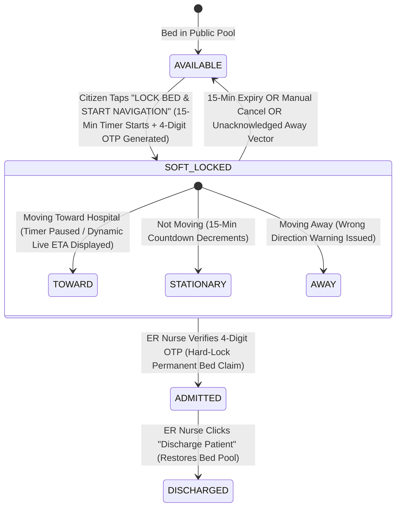
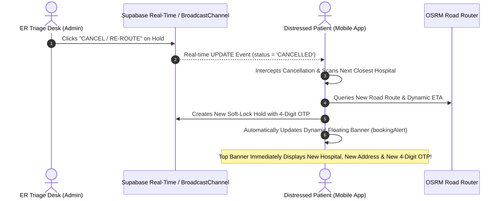

# 🔐 Document 4: Soft-Lock & Hard-Lock Bed Reservation Engine

This document provides a detailed technical specification of ASHA's **15-Minute Soft-Lock Bed Reservation Engine**, **GPS Telemetry & Vector Movement Tracker**, and **Direct 4-Digit Gate OTP Verification System**.

---

## 🏆 Project Identification & System Mission

- **Team Name:** `TEAM ASHA`
- **Team Leader:** `SHAYAK DAS`
- **Category:** `Student Innovation (Open Category — Theme: MedTech / BioTech / HealthTech)`
- **Problem Statement Title:** `Mitigating Emergency Golden-Hour Fatalities Caused by In-Transit Bed Allocation Latency and Static Hospital Resource Visibility`

---

## ⏳ 1. The 15-Minute Soft-Lock Bed Reservation System

During a medical emergency, the journey to the hospital represents a dangerous window of uncertainty. Patients often arrive only to find that the last bed was claimed 2 minutes prior, resulting in fatal gate rejections and ambulance wandering. ASHA eliminates this race condition by allowing citizens to place a **15-Minute Soft-Hold** on an available bed while en route.



---

## ⚙️ 2. Step-by-Step Soft-Lock Execution Engine

When a patient or bystander initiates a bed reservation (`handleBookSlot` in `v2/src/App.tsx`):

### 1. Ward Bed Validation & Fallback Guard:
- Checks if the user is booking a general emergency request (*"nearest hospital"*, *"emergency"*, *"doctor"*).
- **Strict Ward Assignment:** Automatically locks a **General Ward (`general_oxygen`)** bed to prevent non-critical patients from hoarding ICU capacity. For critical conditions (e.g. chest pain / `বুকে ব্যথা`), routes to `cardiac_icu`.

### 2. Optimistic UI Bed Count Mutation:
- Immediately decrements `available_now` by 1 and increments `held_now` by 1 in local React state across all rendered hospital cards and map drawers.
- Ensures the UI reflects instant responsiveness without waiting for cloud network round-trips.

### 3. Cryptographic 4-Digit OTP Generation:
- Generates a secure, human-readable 4-digit numeric verification passcode:
  ```typescript
  const randomOtp = Math.floor(1000 + Math.random() * 9000).toString();
  ```

### 4. Supabase Cloud Database Insertion:
- Pushes an active hold record to the Supabase `active_holds` table with an initial status of `'ACTIVE'` and a 15-minute expiration timestamp (`expires_at = Date.now() + 900 * 1000`).
- Real-time WebSocket triggers notify the hospital's ER desk portal instantly.

### 5. UI Transformation to Situational First-Aid Guidance (OUR BIGGEST PLUS POINT):
- The citizen app immediately transitions into the **En-Route Care Sheet** (`ClinicalProtocolSheet.tsx`).
- While the bed is held, the screen provides:
  - Immediate life-saving physical posture (e.g., Semi-Fowler 45° elevation with bent knees for cardiac patients; Recovery Position for stroke/unconscious patients).
  - 10-second rapid ABC assessment.
  - Numbered step-by-step first-aid protocols.
  - **CRITICAL DO NOT DO Warnings** (e.g., never give water/food to unconscious victims, never allow cardiac patients to walk).
  - Bystander Calming Script to eliminate panic during transit.

---

## 🚘 3. GPS Telemetry & Vector Tracking Engine

To prevent malicious hoarding (e.g., users holding beds without traveling or malicious scalpers holding beds across town), ASHA runs a **Real-Time GPS Telemetry Loop** sampling device movement every 10 seconds.

### Telemetry Mathematical Derivative:
The system computes the rate of distance change relative to the target hospital:

$$\text{Velocity Vector } (\text{km/h}) = \frac{d(t_2) - d(t_1)}{t_2 - t_1} \times 3600$$

- Where $d(t_1)$ and $d(t_2)$ represent the Haversine distances to the hospital at consecutive sampling intervals.

```mermaid
graph TD
    Telemetry[📡 GPS Sampling - Every 10 Seconds] --> VectorCalc{Rate of Distance Change}
    
    VectorCalc -->|Distance Decreasing < -0.5 km/h| Toward[🟢 Vector: TOWARD]
    VectorCalc -->|Distance Stable |d| <= 0.5 km/h| Stationary[🟡 Vector: STATIONARY]
    VectorCalc -->|Distance Increasing > +0.5 km/h| Away[🔴 Vector: AWAY]
    
    Toward --> Action1[Pause 15-Min Countdown & Render Live Dynamic ETA]
    Stationary --> Action2[Decrement 15-Min Countdown Timer]
    Away --> Action3[Trigger Wrong Direction Warning Alert]
    
    Action3 --> CheckAck{User Corrects Route?}
    CheckAck -->|Yes| Toward
    CheckAck -->|No / Continues Away 2-3x| AutoCancel[❌ Auto-Cancel Hold & Restore Bed to Pool]
```

### Vector Behavioral States & Action Matrix:

| Vector State | Mathematical Trigger | User UI Display | Timer Behavior | System Action |
| :--- | :--- | :--- | :--- | :--- |
| **`TOWARD`** | $\frac{\Delta d}{\Delta t} < -0.5 \text{ km/h}$ | `"En Route • Arriving in X Mins"` | **PAUSED** | Live ETA dynamically updates as distance decreases. Countdown timer is frozen to prevent panic. |
| **`STATIONARY`** | $\left\|\frac{\Delta d}{\Delta t}\right\| \le 0.5 \text{ km/h}$ | `"Hold Expiring in MM:SS"` | **ACTIVE (Decrements)** | 15-minute countdown continues to decrement every 1 sec. |
| **`AWAY`** | $\frac{\Delta d}{\Delta t} > +0.5 \text{ km/h}$ | `⚠️ "Wrong Direction Alert!"` | **ACTIVE (Decrements)** | Prompts user. Auto-cancels hold if movement continues away over 2–3 consecutive checks. |

---

## 🔑 4. Gate OTP Check-In & Hard-Lock Admission

### A. Why 4-Digit OTP Replaced QR Code Scanning:
1. **Physical Emergency Bay Reality:** At 2 AM, ambulances arrive in heavy rain, darkness, or high commotion. Rushing paramedics cannot wait for camera alignment.
2. **Fragile Hardware:** Patient phones are frequently shattered, smudged with blood/water, or have low battery/dimmed backlights. Handheld 2D optical barcode scanners routinely fail under screen glare, cracked tempered glass, and scratched scanner optics.
3. **Verbal Transmission:** A 4-digit numeric OTP can be spoken aloud in 2 seconds ("OTP is 4892"), transmitted over phone dispatch, or read off an SMS backup.
4. **Zero-Equipment Overhead:** Requires no expensive barcode scanner at hospital reception desks—nurses type 4 digits on any keyboard or tablet in under 2 seconds.

### B. Hard-Lock Execution Flow:
Upon physical arrival at the hospital emergency room:
1. The paramedic or bystander presents/speaks the 4-digit OTP (e.g., `4892`) to the ER desk nurse.
2. The nurse inputs the 4-digit OTP into the **Patient Check-In Terminal** on the Hospital Admin Portal (`ashaien-admin.vercel.app`).
3. **Hard-Lock Execution:**
   - Supabase updates `active_holds` status from `'ACTIVE'` to `'ADMITTED'`.
   - Inserts an official check-in record in `admitted_patients`.
   - Permanently deducts 1 bed capacity from the hospital ward.
   - Triggers the **Green Bed Hard-Locked Admission Success Modal** simultaneously on the Admin Desk and the Citizen's phone screen.
4. **Post-Admission Clean Up:**
   - The citizen app clears the active hold and returns to the ready state.
   - Cloud telemetry logs are scheduled for DPDP-compliant purging 60 minutes post-discharge.


---

## 🔄 6. Hospital Admin Cancellation & Automatic Re-Routing with Live Banner Sync

In critical surge events, a hospital's emergency bay may suddenly become overwhelmed (e.g. multi-casualty highway accident or emergency equipment failure), forcing the triage nurse to decline/cancel an incoming soft-hold.



### Key Architectural Behaviors:
1. **Zero Citizen Abandonment:** The patient is never left stranded with a generic "Booking Cancelled" error. The mobile app's real-time cloud listener (`useCloudSync` in `App.tsx`) automatically detects the cancellation and instantly triggers `handleAdminCancellation(cancelledHoldId)`.
2. **Nearest Hospital Re-Routing:** The engine identifies the next nearest emergency-capable facility with staffed beds, calculates the new turn-by-turn road route via OSRM, and transitions navigation coordinates.
3. **Instant 4-Digit OTP Generation:** A fresh, secure 4-digit OTP (`1000–9999`) is generated and registered for the newly assigned hospital bed.
4. **Persistent Top Floating Banner Auto-Sync:** The top floating alert banner (`bookingAlert` state):
   - Immediately switches the hospital name (e.g. from *ILS Hospitals* to *Charnock Hospital*).
   - Updates the target address and distance metrics.
   - Replaces the 4-digit admission OTP with the newly generated OTP.
   - Resets the 15-minute hold timer to guarantee arrival time.
