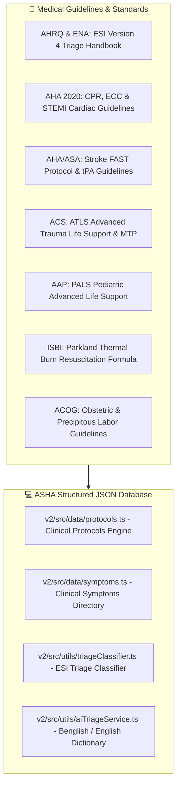
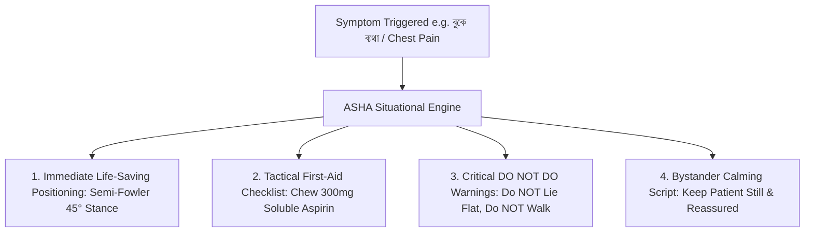

# 🎨 Document 6: Clinical Emergency Protocols & Database Origins

This document explains the medical sources, clinical standards, database architecture, and complete breakdown of all **9 Clinical Emergency Types** supported in ASHA (Automated System for Hospital Allocation).

---

## 🏛️ 1. Where Did We Get Our Medical Database From?

ASHA's emergency protocols database is derived from internationally recognized, peer-reviewed emergency medicine guidelines and standardized hospital triage manuals.

### Official Medical Sources:

1. **Emergency Severity Index (ESI v4) Triage Handbook:**
   - *Source:* Agency for Healthcare Research and Quality (AHRQ) & Emergency Nurses Association (ENA).
   - *Used For:* Categorizing incoming emergencies into ESI-1 (Red Critical), ESI-2 (Yellow Emergent), and ESI-3 (Green Urgent).
2. **American Heart Association (AHA) 2020 Guidelines for CPR & ECC:**
   - *Used For:* Semi-Fowler 45° stance, aspirin chewable administration for STEMI, and 100–120 bpm Code Blue CPR compressions.
3. **AHA/ASA Ischemic Stroke Guidelines & FAST Protocol:**
   - *Used For:* FAST (Face, Arm, Speech, Time) screening, 4.5-hour IV tPA thrombolysis golden window, and lateral recovery positioning.
4. **American College of Surgeons (ACS) ATLS (Advanced Trauma Life Support):**
   - *Used For:* Direct pressure hemorrhage control, high-thigh arterial tourniquet placement, and Massive Transfusion Protocol (MTP).
5. **American Academy of Pediatrics (AAP) PALS (Pediatric Advanced Life Support):**
   - *Used For:* Tepid sponging for pediatric febrile seizures and PICU auto-routing.
6. **Parkland Thermal Burn Resuscitation Standards:**
   - *Used For:* Cool running water irrigation (10–20 minutes) and sterile cling film wrap.
7. **American College of Obstetricians and Gynecologists (ACOG) Guidelines:**
   - *Used For:* Left Lateral Recumbent tilt positioning to relieve inferior vena cava compression during labor.

---

## 🔢 2. How Many Types of Emergencies Do We Have?

ASHA supports **Exactly 9 Primary Clinical Emergency Types**. Each type contains specialized triage rules, assigned wards, ESI ratings, first-aid instructions, do-not safety rules, and bystander scripts:

| # | Emergency Key | Emergency Name & Clinical Description | ESI Level | Target Ward | Immediate First-Aid Stance | Benglish / English Keywords |
|---|---|---|---|---|---|---|
| **1** | **`general`** | **Nearest Hospital / General Emergency** | 🟢 **ESI-3** | `general_oxygen` | Proceed directly to nearest ER. Keep patient comfortable. | `nearest hospital`, `kacher hospital`, `emergency`, `daktar` |
| **2** | **`cardiac`** | **Severe Chest Pain / STEMI Heart Attack** | 🔴 **ESI-1** | `cardiac_icu` | **Semi-Fowler 45° Stance** Leaning back with bent knees. Chew 300mg Soluble Aspirin. | `buke betha`, `buke chap`, `buker betha`, `chest pain`, `heart attack` |
| **3** | **`arrest`** | **Cardiac Arrest / Unresponsive Patient** | 🔴 **ESI-1** | `adult_icu` | **Flat on Floor CPR** 100–120 bpm chest compressions in center of chest. | `behosh`, `agyan`, `cardiac arrest`, `no pulse`, `stopped breathing` |
| **4** | **`stroke`** | **Acute Ischemic Stroke / FAST Protocol** | 🔴 **ESI-1** | `adult_icu` | **Lateral Recovery Position** Head elevated 15–30°. Record exact onset time. | `mukhe baka`, `mukh beke geche`, `katha bolte parchena`, `stroke`, `face droop` |
| **5** | **`trauma`** | **Arterial Bleeding / Massive Trauma** | 🔴 **ESI-1** | `adult_icu` | **Direct Pressure & Tourniquet** Continuous compression; tourniquet 2-3 inches above. | `paaye theke rokto`, `paer rokto`, `arterial bleeding`, `blood loss` |
| **6** | **`pediatric`** | **Pediatric Convulsion & High Fever** | 🔴 **ESI-2** | `pediatric_icu` | **Tepid Sponging** Wipe forehead/body with lukewarm water. Lay child on side. | `bacchar jor`, `baccha khachhe na`, `child fever`, `infant seizure` |
| **7** | **`respiratory`** | **Severe Respiratory Distress / Asthma** | 🔴 **ESI-1** | `general_oxygen` | **Tripod Position Stance** Sit upright leaning forward. Inhaler via spacer. | `sash nite koshto`, `shash koshto`, `shortness of breath`, `asthma attack` |
| **8** | **`burn`** | **Severe Thermal / Chemical Burns** | 🟡 **ESI-2** | `adult_icu` | **Cool Water Irrigation** Cool running water 10–20 mins. Sterile cling wrap. | `burn`, `fire`, `scald`, `electric shock` |
| **9** | **`maternity`** | **Precipitous Labor / Obstetric Emergency** | 🔴 **ESI-1** | `general_oxygen` | **Left Lateral Recumbent Tilt** Lay mother on left side with back pillow. | `pregnancy`, `labor`, `delivery`, `contractions`, `water broke` |

---

## 🌟 4. Our Biggest Plus Point: Situational First-Aid & En-Route Action Protocols

### A. Why This Was Done (The 45-Minute Transit Void)
In India, navigating city traffic or rural corridors to reach a tertiary hospital takes an average of **30 to 45 minutes**. During this high-stress transit window, **professional doctors and paramedics are not present**. 

Clinical research shows that a massive percentage of pre-hospital deaths occur not from the disease itself, but from fatal bystander mistakes committed in panic during transit:
1. **Cardiac Suffocation**: An acute heart attack patient is made to lie flat on the floor or car backseat, causing massive venous fluid backflow into the lungs (acute pulmonary edema) and suffocation.
2. **Fatal Pulmonary Aspiration**: Panic-stricken family members force water or solids down the throat of a drowsy or seizing patient, causing immediate airway obstruction and asphyxiation.
3. **Exsanguinating Hemorrhage**: Bystanders repeatedly peel back blood-soaked cloths to inspect a wound, disrupting the fragile primary platelet plug and bleeding out.
4. **Physical Exertion**: A patient with acute ischemia walks up stairs or to the car, tripling myocardial oxygen demand and triggering fatal ventricular fibrillation.

### B. How ASHA Solves It (Instant Situational Guidance)
The instant an emergency symptom is spoken or typed, ASHA immediately opens the **Situational Emergency Action Sheet** (`ClinicalProtocolSheet.tsx`). It tells the family and bystanders **EXACTLY WHAT TO DO RIGHT NOW IN THE CURRENT SITUATION**:

### C. The 5 Core Components Rendered for Every Emergency:
1. **Acuity Level Badge**: Visual color-coded severity (e.g. `🚨 ESI-1 CRITICAL PRIORITY (CARDIAC ICU)`).
2. **Immediate Action Headline**: High-contrast, single-sentence command (e.g., *"Elevate Torso at 45° Semi-Fowler Stance with Bent Knees"*).
3. **Tactical First-Aid Steps**: Ordered, numbered life-saving actions to perform before reaching the hospital bay.
4. **Safety "DO NOT DO" Flags**: Explicit prohibitions preventing fatal layman errors.
5. **Bystander Calming Script**: Direct reassurance phrases allowing panic-stricken relatives to regain composure and assist the patient.

---

## 📂 5. Where It Lives in the Codebase

1. **Situational UI Component:** [`v2/src/components/ClinicalProtocolSheet.tsx`](file:///d:/HACKATHON/v2/src/components/ClinicalProtocolSheet.tsx)
   - Interactive sliding sheet rendering situational instructions, badges, and warning callouts.
2. **Protocols Knowledge Base:** [`v2/src/data/protocols.ts`](file:///d:/HACKATHON/v2/src/data/protocols.ts)
   - Object mapping of all 9 protocols (`CLINICAL_PROTOCOLS`).
3. **Clinical Symptoms Catalog:** [`v2/src/data/symptoms.ts`](file:///d:/HACKATHON/v2/src/data/symptoms.ts) & [`v2/src/data/symptoms/`](file:///d:/HACKATHON/v2/src/data/symptoms/)
   - Detailed 165+ symptom directory.
4. **Classifier Engine:** [`v2/src/utils/triageClassifier.ts`](file:///d:/HACKATHON/v2/src/utils/triageClassifier.ts)
   - Synchronous Emergency Severity Index (ESI) classification algorithm + `translateBengaliToEnglish`.
5. **AI Triage Dictionary:** [`v2/src/utils/aiTriageService.ts`](file:///d:/HACKATHON/v2/src/utils/aiTriageService.ts)
   - 400+ Benglish, Bengali, & English keyword triage dictionary.
