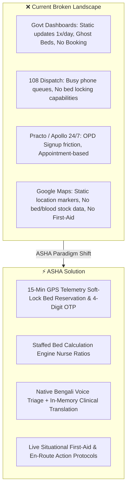
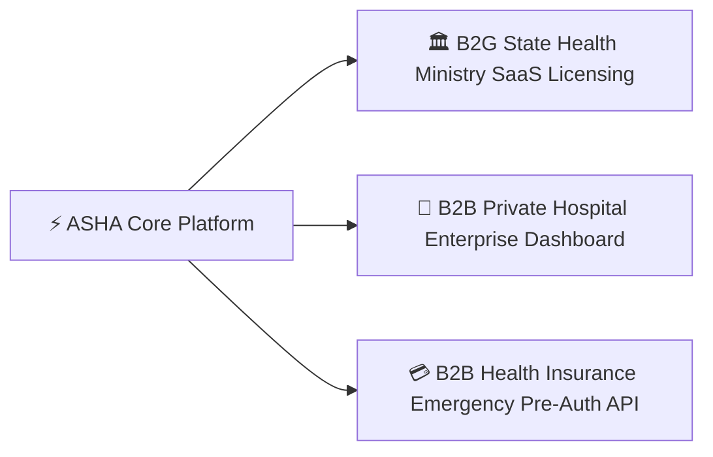

# 📈 Document 8: Master Business, Competition, Feasibility & Scaling Strategy Blueprint

This document provides a comprehensive, high-level analysis of **ASHA (Automated System for Hospital Allocation)** from a business, clinical, competitive, and scalability perspective, articulating **why all of this is done**.

---

## 🏆 Official SIH 2026 Team Identification

- **Team Name:** `TEAM ASHA`
- **Team Leader:** `SHAYAK DAS`
- **Category:** `Student Innovation (Open Category — Theme: MedTech / BioTech / HealthTech)`
- **Problem Statement Title:** `Mitigating Emergency Golden-Hour Fatalities Caused by In-Transit Bed Allocation Latency and Static Hospital Resource Visibility`

---

## 🚑 1. Why ASHA is Critical: The Human Cost of Ambulance Wandering & En-Route Inaction

In emergency medicine, the first 60 minutes following a severe medical crisis—such as a STEMI Heart Attack, Stroke, or Arterial Hemorrhage—is known as the **Golden Hour**. Medical outcomes decrease exponentially for every minute that care is delayed.

Currently, thousands of emergency patients die each year due to two fatal systemic gaps:
1. **Ambulance Wandering:** Ambulances wander between 3 or 4 hospitals searching for an available bed because static portals display "Ghost Beds" (physical furniture without assigned nurses).
2. **The En-Route Black Hole (Transit Void):** During the 30–45 minutes of ambulance transit, terrified family members panic and either do nothing or commit fatal mistakes (like pouring water into an unconscious person's mouth, causing fatal aspiration into the lungs).

ASHA eliminates both bottlenecks by creating an **Instant Real-Time Emergency Grid** that matches patients to equipped hospitals, soft-locks a bed for 15 minutes, provides immediate **Situational First-Aid Guidance** en route, and admits patients via a **4-Digit OTP** in under 2 seconds.

---

## 🛠️ 2. Feasibility Analysis: Why ASHA Can Be Deployed Today

| Feasibility Dimension | Analysis & Implementation Strategy |
| :--- | :--- |
| **Hardware Barrier** | **Zero Hardware Cost.** Operates entirely on standard web browsers (smartphones, PCs, cheap Android tablets). No custom hospital hardware or expensive barcode scanners required. |
| **Network & Bandwidth** | **Ultra-Low Bandwidth.** Optimized lightweight JSON payloads ($<2\text{ KB}$ per update) function reliably over $3\text{G}$ and congested $4\text{G}$ networks. |
| **Hospital Staff Adoption** | **Zero-Friction Workflow.** Nurses do not type lengthy clinical forms. Bed counts decrement automatically upon booking and hard-lock with a 4-digit OTP entry ($<2\text{ seconds}$). |
| **Cost to Deploy** | **$0 Initial Infrastructure.** Deployed on open-source vector maps (Leaflet + OpenStreetMap + OSRM) and cloud infrastructure (Vercel + Supabase). |
| **Language Inclusivity** | **Native Bengali Script & English.** In-memory clinical translation maps spoken Bengali (`বুকে ব্যথা`) into clinical English with zero latency and 0 API cost. |

---

## 🔍 3. Current Gaps in Existing Solutions & How ASHA Fixes Them

### Breakdown of Existing Failures:
1. **Government Dashboards (WB Swasthya Sathi / Ayushman Bharat):**
   - *Gap:* Updated manually once a day by administrative clerks. Display "Ghost Beds" (physical furniture without nurses). No reservation capabilities.
   - *ASHA Fix:* Dynamic WebSocket updates. Calculates **Staffed Beds** based on on-duty nurses. Allows 15-minute soft-holds.
2. **108 Emergency Ambulance Dispatch:**
   - *Gap:* Phone dispatchers face heavy call queue congestion. Dispatchers have no real-time visibility into hospital ICU bed availability.
   - *ASHA Fix:* Live digital map showing nearest hospitals with available staffed beds, blood stock, and live routing.
3. **OPD & Telemedicine Apps (Practo / Apollo 24/7):**
   - *Gap:* Designed for non-urgent doctor appointments days in advance. Require mandatory phone signups and OTP logins.
   - *ASHA Fix:* **Zero-Signup Instant Access**. Built exclusively for Golden Hour resuscitation.
4. **Standard Mapping Platforms (Google Maps / Apple Maps):**
   - *Gap:* Static geographic markers without medical triage, ward bed status, blood stock visibility, or en-route medical guidance.
   - *ASHA Fix:* Live emergency hospital grid displaying real-time ward bed counts, Cath Lab readiness, blood bank units, and immediate situational first-aid instructions.

---

## 🌟 4. Key Differentiating Factors & Innovations

1. **Live Situational First-Aid Protocols (OUR BIGGEST PLUS POINT):** Tells bystanders *exactly what to do right now in the current situation* (Semi-Fowler 45° posture, recovery position, tourniquet application, and critical DO NOT DO warnings) to stabilize patients while the ambulance is en route.
2. **Native Bengali Speech Translation (`translateBengaliToEnglish`):** Translates native Bengali script (`বুকে ব্যথা`) into canonical English clinical terms with zero cloud latency and 0 API cost.
3. **15-Minute GPS Vector Telemetry Soft-Lock:** Reserves a bed immediately while the patient travels, pausing the timer when moving toward the hospital and tracking direction vectors.
4. **Direct 4-Digit Gate OTP Verification:** Spoken aloud in 2 seconds at the ER bay, eliminating fragile optical QR scanners in the rain and dark.
5. **Staffed Bed vs. Ghost Bed Ratio Engine:** Automatically calculates actual usable beds based on on-duty shift nurses ($1:1$ ICU, $1:2$ PICU, $1:6$ Ward).
6. **Automated Emergency Preemption Re-Routing:** If an ER desk re-allocates a bed for an incoming Code Blue resuscitation, ASHA automatically plays an audio alert, displays a red alert banner, auto-books the next nearest hospital, and transfers all patient details seamlessly.

---

## 💼 5. Business & Profitability Strategy (Monetizing Without Harming Core Mission)

ASHA preserves its free public emergency service while generating revenue through high-value institutional models:

### Monetization Streams:
1. **B2G (Business-to-Government) State Health Ministry SaaS Licensing:**
   - License ASHA as the official State Emergency Grid Command Dashboard for state health departments (e.g., West Bengal Health Department, Ayushman Bharat).
   - Provides central health authorities with live heatmaps of regional bed utilization, ER bottlenecks, and ambulance dispatch efficiency.
2. **B2B Private Hospital Enterprise Subscriptions:**
   - Private hospital chains (AMRI, Apollo, Fortis, Woodlands) pay a monthly subscription fee for enterprise ER desk analytics, custom HIS/EMR integration webhooks, and priority bed visibility.
3. **B2B Health Insurance Pre-Authorization API:**
   - Health insurance providers (Star Health, HDFC ERGO, ICICI Lombard) pay for API access to verify emergency patient check-ins instantly, enabling instant cashless pre-authorization.

---

## 📊 6. Comprehensive Competitor Matrix

| Feature / Metric | ASHA | Govt Dashboards | Practo / Apollo 24/7 | 108 Dispatch | Google Maps |
| :--- | :---: | :---: | :---: | :---: | :---: |
| **Real-Time Bed Booking** | ✅ **Yes (15-Min Soft-Lock)** | ❌ No | ❌ No | ❌ No | ❌ No |
| **Live Situational First-Aid** | ✅ **Yes (Our Biggest Plus Point)** | ❌ No | ❌ No | ❌ No | ❌ No |
| **Staffed vs Ghost Bed Math** | ✅ **Yes (Nurse Ratios)** | ❌ No | ❌ No | ❌ No | ❌ No |
| **Gate Verification Speed** | ✅ **<2s (4-Digit OTP)** | ❌ Manual paper | ❌ No gate check | ❌ Phone call | ❌ None |
| **Native Bengali Script Support**| ✅ **Yes (In-Memory Clinical)**| ❌ Raw/Static | ❌ English only | ⚠️ Phone verbal | ❌ None |
| **Anti-Hoarding Telemetry** | ✅ **Yes (Vector Tracking)**| ❌ No | ❌ No | ❌ No | ❌ No |
| **Zero-Signup Access** | ✅ **Yes (0 Friction)** | ❌ Heavy login | ❌ Mandatory signup | ✅ Verbal phone | ✅ Open search |
| **Hospital ER Desk Sync** | ✅ **Yes (Realtime WebSockets)**| ❌ Batch sync | ❌ OPD calendar only | ❌ Manual radio | ❌ None |
| **Blood Bank Component Units** | ✅ **Yes (PRBC/Platelet/Plasma)**| ⚠️ Often stale | ❌ No blood stock | ⚠️ Call-based | ❌ None |
