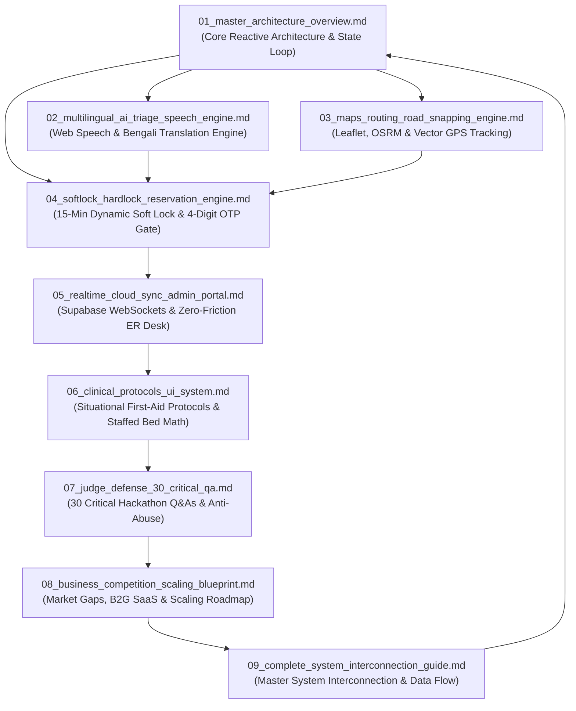
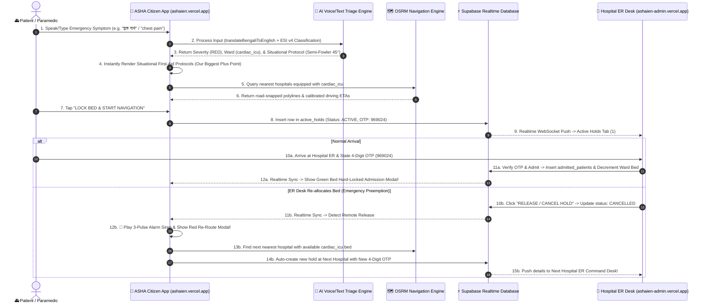

# 🗺️ ASHA (Automated System for Hospital Allocation) — Complete System Interconnection & Master Integration Blueprint

---

## 🏆 Official SIH 2026 Team Identification

- **Team Name:** `TEAM ASHA`
- **Team Leader:** `SHAYAK DAS`
- **Category:** `Student Innovation (Open Category — Theme: MedTech / BioTech / HealthTech)`
- **Problem Statement Title:** `Mitigating Emergency Golden-Hour Fatalities Caused by In-Transit Bed Allocation Latency and Static Hospital Resource Visibility`

---

## 📌 Executive Summary & Architecture Paradigm

**ASHA (Automated System for Hospital Allocation)** is an end-to-end, zero-signup emergency resuscitation medtech web engine designed to eliminate **Ambulance Wandering** and **Pre-Hospital In-Transit Fatalities** during the critical **Golden Hour** (the first 60 minutes of medical trauma).

Unlike legacy static hospital portals or generic appointment apps (e.g. Practo, Apollo 24/7), ASHA operates as an **Autonomous Emergency Grid Engine**. It seamlessly bridges real-time clinical triage, dynamic road-snapping GPS navigation, atomic 15-minute bed reservations, real-time cloud synchronization with hospital ER command desks, **Live Situational First-Aid Protocols (Our Biggest Plus Point)**, and an **Automated Emergency Preemption Re-Routing System**.

This document serves as the **Master Interconnection Guide**, detailing how every component and dossier document in the ASHA technical suite fits into a single, cohesive architecture.

---

## 🌐 The 9-Document Technical Dossier System

The ASHA documentation suite is structured into 9 interconnected blueprints. Each file addresses a specific pillar of the platform while referencing and building upon the others:

---

## 🔗 How Each Document Connects & Why It Is Critical

### 1. `01_master_architecture_overview.md` — The Foundation & Central Neural Loop
- **What It Contains:** Comprehensive architectural breakdown of ASHA, explaining the reactive single-page app state machine, zero-signup instant access model, component dependency tree, and state management flow.
- **How It Connects:** Acts as the **Central Hub**. It imports the triage output from Document 02, feeds spatial coordinates into Document 03, enforces the lock lifecycle in Document 04, and synchronizes state via Document 05.
- **Why It Is Important:** Judges will inspect this document first to verify that ASHA is a production-grade engineered system rather than a disconnected set of UI screens.

### 2. `02_multilingual_ai_triage_speech_engine.md` — Clinical Input & Internal Medical Translation
- **What It Contains:** Continuous speech recognition (Web Speech API with 2.2s debounce), native Bengali-to-English medical translation engine (`translateBengaliToEnglish`), phonetic mishearing normalizer, and Emergency Severity Index (ESI) classification.
- **Why It Is Important:** When citizens speak in Bengali (`বুকে ব্যথা`), the browser transcribes native script. Downstream clinical databases and ESI ward classifiers operate on standard English terminology. ASHA's internal translation engine bridges this gap in zero latency, processing the emergency **as if the user had spoken in English in the first place**, while maintaining complete native language transparency on the UI!

### 3. `03_maps_routing_road_snapping_engine.md` — Geospatial & Live Vector Navigation
- **What It Contains:** Leaflet map rendering, OpenStreetMap (OSRM) shortest driving route generation (<420ms computation), polyline decoding, OSRM nearest road snapping, dynamic ETA stabilization, and GPS directional movement vector evaluation (`TOWARD`, `STATIONARY`, `AWAY`).
- **Why It Is Important:** Eliminates ETA recalculation jitter/flickering and provides a native Google Maps-like experience without relying on expensive, rate-limited proprietary API keys.

### 4. `04_softlock_hardlock_reservation_engine.md` — Atomic Bed Holds & Direct 4-Digit OTP Gate
- **What It Contains:** Deep dive into the 15-minute dynamic soft-lock reservation algorithm, atomic bed decrement logic, 4-digit entrance OTP generation, and direct ER desk admission verification (replacing fragile optical QR scanning).
- **Why It Is Important:** Solves the #1 cause of Golden Hour mortality — patients arriving at a hospital only to find that the last available bed was taken 2 minutes prior. Direct OTP works in 2 seconds in a chaotic ER bay, in the dark, with zero specialized scanner hardware.

### 5. `05_realtime_cloud_sync_admin_portal.md` — ER Command Desk & Bidirectional Sync
- **What It Contains:** Specification of the Hospital Admin Command Portal (`ashaien-admin.vercel.app`), real-time Supabase WebSocket subscriptions, bed capacity overrides, blood stock controls, patient check-in terminal, and hold release/cancellation handling.
- **Why It Is Important:** Empowers hospital staff with a zero-training, 1-tap command interface that keeps emergency inventory 100% synchronized across the city.

### 6. `06_clinical_protocols_ui_system.md` — Situational First-Aid Guidance & Staffed Bed Math
- **What It Contains:** Our **BIGGEST PLUS POINT**: The Situational Emergency First-Aid Sheet (`ClinicalProtocolSheet.tsx`), providing immediate life-saving positioning (Semi-Fowler 45° posture, tourniquet/direct pressure, recovery position), step-by-step tactical checklists, and critical DO NOT DO warnings for family members while the ambulance is en route. Also details the **Staffed Bed Formula** ($B_{staffed} = \min(B_{phys}, N_{duty} \times Ratio)$).
- **Why It Is Important:** Preserves life during the 30–45 minute transit window before reaching ER doctors, preventing fatal layman mistakes (e.g. cardiac suffocation from lying flat, or fatal water aspiration).

### 7. `07_judge_defense_30_critical_qa.md` — Hackathon Defense & Stress-Test Armor
- **What It Contains:** Official team details (`TEAM ASHA`, `SHAYAK DAS`, Student Innovation Open Category), plus razor-sharp defenses on liability, black-market anti-scalping, offline crisis protocols, OTP vs QR rationale, and why Situational First-Aid is our primary differentiator.
- **Why It Is Important:** Gives hackathon judges absolute confidence that ASHA is resilient against abuse, operational friction, and technical scrutiny.

### 8. `08_business_competition_scaling_blueprint.md` — Monetization, Scaling & Competitor Matrix
- **What It Contains:** Deep dive into public health impact, B2G state health ministry SaaS licensing, B2B hospital command center dashboards, 3-phase national rollout plan, and feature-by-feature competitor analysis against Practo, Apollo 24/7, WB Swasthya Sathi, 108 Dispatch, and Google Maps.
- **Why It Is Important:** Demonstrates to judges and investors that ASHA is not just a hackathon demo, but a scalable, self-sustaining emergency medical enterprise.

### 9. `09_complete_system_interconnection_guide.md` — Master Integration Blueprint
- **What It Contains:** This synthesis blueprint showing end-to-end emergency data flow, cross-document connections, and live deployment endpoints.

---

## ⚡ Complete End-to-End Emergency Data Flow

---

## 🏆 Summary Matrix of the ASHA Dossier Suite

| Doc # | File Basename | Core Domain | Key Output / Artifact |
| :---: | :--- | :--- | :--- |
| **01** | `01_master_architecture_overview.md` | Architecture | Single-Page Reactive Loop & Component Map |
| **02** | `02_multilingual_ai_triage_speech_engine.md` | Clinical Triage | Bengali-to-Clinical Translation & ESI Classifier |
| **03** | `03_maps_routing_road_snapping_engine.md` | Navigation | OSRM Road Snapper & Directional Vector Tracking |
| **04** | `04_softlock_hardlock_reservation_engine.md` | Bed Management | 15-Min Dynamic Soft Lock & 4-Digit OTP Gate Engine |
| **05** | `05_realtime_cloud_sync_admin_portal.md` | Cloud & Admin | Supabase Realtime Sync & ER Desk Terminal |
| **06** | `06_clinical_protocols_ui_system.md` | Design & Clinical | Situational First-Aid Protocols & Staffed Bed Math |
| **07** | `07_judge_defense_30_critical_qa.md` | Defense & QA | 30 Critical Judge Defense Q&As & Stress Tests |
| **08** | `08_business_competition_scaling_blueprint.md` | Business & Scale | B2G SaaS Monetization & Competitor Matrix |
| **09** | `09_complete_system_interconnection_guide.md` | Integration | Master Interconnection Guide & System Flow |

---

## 🚀 Live Production Web Applications

- **ASHA Citizen Resuscitation App:** [https://ashaien.vercel.app](https://ashaien.vercel.app)
- **ASHA Hospital ER Command Desk:** [https://ashaien-admin.vercel.app](https://ashaien-admin.vercel.app)
