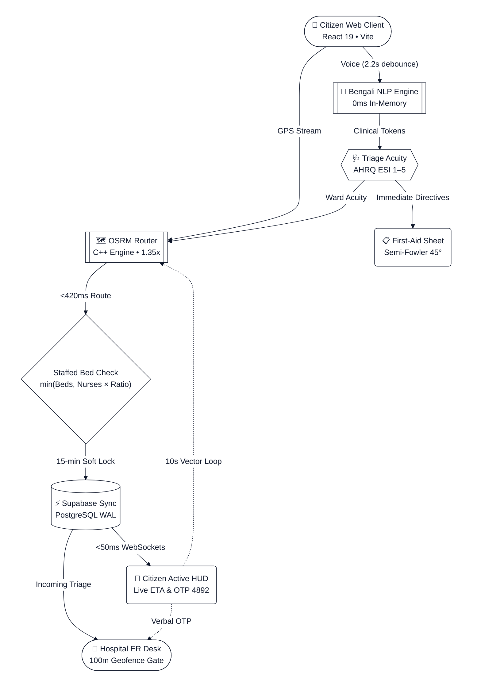
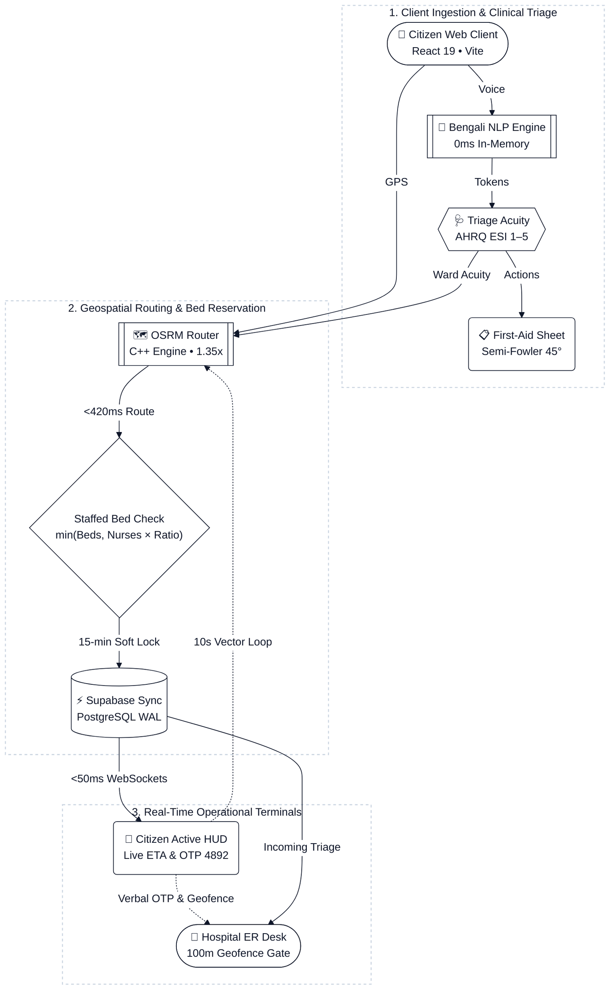

# System Architecture Flowchart (Balanced 2-Tier Layout for Slide Placement)

### Why this fixes the slide overflow issue:
In a single-line `flowchart LR`, all 9 nodes were placed side-by-side, creating an extreme **11:1 aspect ratio** that stretched horizontally across the slide and collided with the mobile phone mockup.

This updated version uses a **2-tier balanced grid (`flowchart TB` with horizontal rows)**:
- **Top Row (4 nodes):** Citizen Client $\rightarrow$ Bengali NLP $\rightarrow$ Triage Acuity $\rightarrow$ First-Aid Sheet.
- **Bottom Row (5 nodes):** OSRM Router $\rightarrow$ Staffed Bed Check $\rightarrow$ Supabase Sync $\rightarrow$ Citizen HUD $\rightarrow$ Hospital ER Desk.
- **Aspect Ratio:** **~2.6 : 1**, which matches the physical **8.35" × 2.90"** white card area on the slide.
- **Font:** Uses **`Agency FB`** (condensed, high-contrast typography).
- **Styling:** Pure white background, clean dark navy outlines (`#0F172A`), no effects, subtle logical shapes (stadium pill, subroutine, hexagon, rounded box, diamond, cylinder).

---

## 📋 Recommended Code (Pure Nodes, Invisible Subgraph Containers)

---

## 🎨 Alternative: 3-Tier Categorized Stack (With Labeled Section Tiers)

