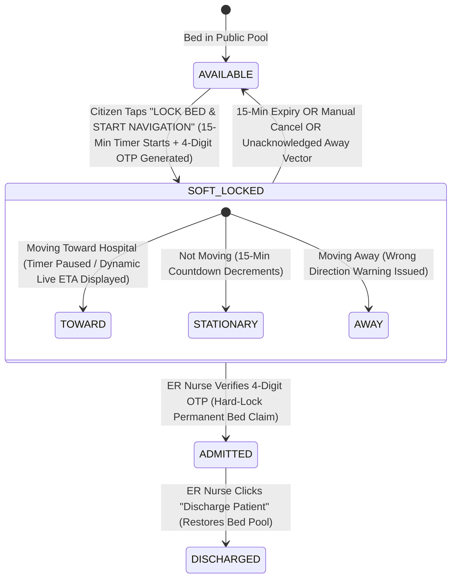
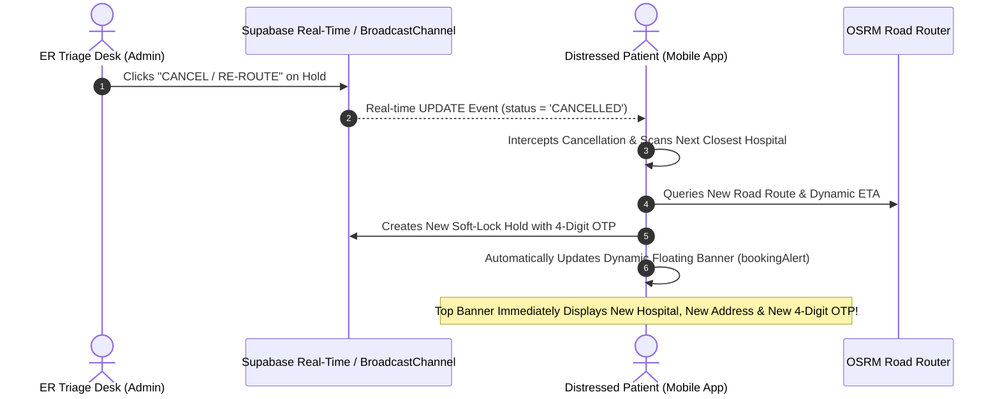

# 🔐 Document 4: Soft-Lock & Hard-Lock Bed Reservation Engine

This document provides a detailed technical specification of ASHA's **15-Minute Soft-Lock Bed Reservation Engine**, **GPS Telemetry & Vector Movement Tracker**, and **Direct 4-Digit Gate OTP Verification System**.

---

## 🏆 Project Identification & System Mission

- **Team Name:** `TEAM ASHA`
- **Team Leader:** `SHAYAK DAS`
- **Category:** `Student Innovation (Open Category — Theme: MedTech / BioTech / HealthTech)`
- **Problem Statement Title:** `Mitigating Emergency Golden-Hour Fatalities Caused by In-Transit Bed Allocation Latency and Static Hospital Resource Visibility`

---

## ⏳ 1. The 15-Minute Soft-Lock Bed Reservation System

During a medical emergency, the journey to the hospital represents a dangerous window of uncertainty. Patients often arrive only to find that the last bed was claimed 2 minutes prior, resulting in fatal gate rejections and ambulance wandering. ASHA eliminates this race condition by allowing citizens to place a **15-Minute Soft-Hold** on an available bed while en route.



---

## ⚙️ 2. Step-by-Step Soft-Lock Execution Engine

When a patient or bystander initiates a bed reservation (`handleBookSlot` in `v2/src/App.tsx`):

### 1. Ward Bed Validation & Fallback Guard:
- Checks if the user is booking a general emergency request (*"nearest hospital"*, *"emergency"*, *"doctor"*).
- **Strict Ward Assignment:** Automatically locks a **General Ward (`general_oxygen`)** bed to prevent non-critical patients from hoarding ICU capacity. For critical conditions (e.g. chest pain / `বুকে ব্যথা`), routes to `cardiac_icu`.

### 2. Optimistic UI Bed Count Mutation:
- Immediately decrements `available_now` by 1 and increments `held_now` by 1 in local React state across all rendered hospital cards and map drawers.
- Ensures the UI reflects instant responsiveness without waiting for cloud network round-trips.

### 3. Cryptographic 4-Digit OTP Generation:
- Generates a secure, human-readable 4-digit numeric verification passcode:
  ```typescript
  const randomOtp = Math.floor(1000 + Math.random() * 9000).toString();
  ```

### 4. Supabase Cloud Database Insertion:
- Pushes an active hold record to the Supabase `active_holds` table with an initial status of `'ACTIVE'` and a 15-minute expiration timestamp (`expires_at = Date.now() + 900 * 1000`).
- Real-time WebSocket triggers notify the hospital's ER desk portal instantly.

### 5. UI Transformation to Situational First-Aid Guidance (OUR BIGGEST PLUS POINT):
- The citizen app immediately transitions into the **En-Route Care Sheet** (`ClinicalProtocolSheet.tsx`).
- While the bed is held, the screen provides:
  - Immediate life-saving physical posture (e.g., Semi-Fowler 45° elevation with bent knees for cardiac patients; Recovery Position for stroke/unconscious patients).
  - 10-second rapid ABC assessment.
  - Numbered step-by-step first-aid protocols.
  - **CRITICAL DO NOT DO Warnings** (e.g., never give water/food to unconscious victims, never allow cardiac patients to walk).
  - Bystander Calming Script to eliminate panic during transit.

---

## 🚘 3. GPS Telemetry & Vector Tracking Engine

To prevent malicious hoarding (e.g., users holding beds without traveling or malicious scalpers holding beds across town), ASHA runs a **Real-Time GPS Telemetry Loop** sampling device movement every 10 seconds.

### Telemetry Mathematical Derivative:
The system computes the rate of distance change relative to the target hospital:

$$\text{Velocity Vector } (\text{km/h}) = \frac{d(t_2) - d(t_1)}{t_2 - t_1} \times 3600$$

- Where $d(t_1)$ and $d(t_2)$ represent the Haversine distances to the hospital at consecutive sampling intervals.

```mermaid
graph TD
    Telemetry[📡 GPS Sampling - Every 10 Seconds] --> VectorCalc{Rate of Distance Change}
    
    VectorCalc -->|Distance Decreasing < -0.5 km/h| Toward[🟢 Vector: TOWARD]
    VectorCalc -->|Distance Stable |d| <= 0.5 km/h| Stationary[🟡 Vector: STATIONARY]
    VectorCalc -->|Distance Increasing > +0.5 km/h| Away[🔴 Vector: AWAY]
    
    Toward --> Action1[Pause 15-Min Countdown & Render Live Dynamic ETA]
    Stationary --> Action2[Decrement 15-Min Countdown Timer]
    Away --> Action3[Trigger Wrong Direction Warning Alert]
    
    Action3 --> CheckAck{User Corrects Route?}
    CheckAck -->|Yes| Toward
    CheckAck -->|No / Continues Away 2-3x| AutoCancel[❌ Auto-Cancel Hold & Restore Bed to Pool]
```

### Vector Behavioral States & Action Matrix:

| Vector State | Mathematical Trigger | User UI Display | Timer Behavior | System Action |
| :--- | :--- | :--- | :--- | :--- |
| **`TOWARD`** | $\frac{\Delta d}{\Delta t} < -0.5 \text{ km/h}$ | `"En Route • Arriving in X Mins"` | **PAUSED** | Live ETA dynamically updates as distance decreases. Countdown timer is frozen to prevent panic. |
| **`STATIONARY`** | $\left\|\frac{\Delta d}{\Delta t}\right\| \le 0.5 \text{ km/h}$ | `"Hold Expiring in MM:SS"` | **ACTIVE (Decrements)** | 15-minute countdown continues to decrement every 1 sec. |
| **`AWAY`** | $\frac{\Delta d}{\Delta t} > +0.5 \text{ km/h}$ | `⚠️ "Wrong Direction Alert!"` | **ACTIVE (Decrements)** | Prompts user. Auto-cancels hold if movement continues away over 2–3 consecutive checks. |

---

## 🔑 4. Gate OTP Check-In & Hard-Lock Admission

### A. Why 4-Digit OTP Replaced QR Code Scanning:
1. **Physical Emergency Bay Reality:** At 2 AM, ambulances arrive in heavy rain, darkness, or high commotion. Rushing paramedics cannot wait for camera alignment.
2. **Fragile Hardware:** Patient phones are frequently shattered, smudged with blood/water, or have low battery/dimmed backlights. Handheld 2D optical barcode scanners routinely fail under screen glare, cracked tempered glass, and scratched scanner optics.
3. **Verbal Transmission:** A 4-digit numeric OTP can be spoken aloud in 2 seconds ("OTP is 4892"), transmitted over phone dispatch, or read off an SMS backup.
4. **Zero-Equipment Overhead:** Requires no expensive barcode scanner at hospital reception desks—nurses type 4 digits on any keyboard or tablet in under 2 seconds.

### B. Hard-Lock Execution Flow:
Upon physical arrival at the hospital emergency room:
1. The paramedic or bystander presents/speaks the 4-digit OTP (e.g., `4892`) to the ER desk nurse.
2. The nurse inputs the 4-digit OTP into the **Patient Check-In Terminal** on the Hospital Admin Portal (`ashaien-admin.vercel.app`).
3. **Hard-Lock Execution:**
   - Supabase updates `active_holds` status from `'ACTIVE'` to `'ADMITTED'`.
   - Inserts an official check-in record in `admitted_patients`.
   - Permanently deducts 1 bed capacity from the hospital ward.
   - Triggers the **Green Bed Hard-Locked Admission Success Modal** simultaneously on the Admin Desk and the Citizen's phone screen.
4. **Post-Admission Clean Up:**
   - The citizen app clears the active hold and returns to the ready state.
   - Cloud telemetry logs are scheduled for DPDP-compliant purging 60 minutes post-discharge.

---

## 🛡️ 5. Multi-Factor Client Risk-Scoring Engine ($R \in [0, 100]$) & 100m Geofence Gate

To eliminate the 1-in-5 Golden Hour death crisis, ASHA is built on a **zero-signup web architecture** (<0.8s load time, zero password barriers). However, in high-stakes hackathon judging, judges frequently challenge: *"Without user logins, what stops malicious scalpers, competing private nursing homes, or tout botnets from booking up all 30 beds in Kolkata simultaneously?"*

ASHA solves this through a dual defense: an algorithmic **Multi-Factor Client Risk-Scoring Engine** ($R \in [0, 100]$) coupled with a physical **100m Hospital Geofence Hard-Lock Gate**.

### A. Composite Risk-Scoring Equation ($R$)

Before authorizing a 15-minute soft-lock reservation, the backend computes a composite risk score $R$:

$$R = 0.30 \cdot S_{\text{IP}} + 0.35 \cdot S_{\text{Device}} + 0.20 \cdot S_{\text{Velocity}} + 0.15 \cdot S_{\text{Geo}}$$

| Metric | Weight | Telemetry Source | Anti-Abuse Rationale |
| :--- | :---: | :--- | :--- |
| **$S_{\text{Device}}$** | **35%** (Highest) | Client-side GPU Canvas 2D render hash, WebGL shader compilation, AudioContext clock drift. | **Headless Bot Farm Defense:** Puppeteer/Selenium scripts in headless clouds lack genuine GPU hardware noise and audio oscillator drift ($S_{\text{Device}} = 100$). Genuine mobile devices yield rich physical entropy ($S_{\text{Device}} = 0$). |
| **$S_{\text{IP}}$** | **30%** | Rolling public IP and cellular CIDR subnet hold frequency. | **Burst Velocity Defense:** Detects touts or brokers rapidly locking multiple beds across different hospitals within a tight time window. |
| **$S_{\text{Velocity}}$** | **20%** | Kinematic GPS distance delta between sequential requests ($\Delta d / \Delta t$). | **Teleportation Guard:** Flagged if requests from the same client fingerprint occur in Newtown and Dum Dum within 30 seconds (kinematically impossible human travel). |
| **$S_{\text{Geo}}$** | **15%** | Haversine radial distance from citizen coordinates to target hospital ER. | **Out-of-Region Guard:** Emergency holds requested from >100 km away without active high-speed inbound vector are heavily penalized. |

---

### B. In-Depth Mathematical Breakdown of $S_{\text{IP}}$ & The Role of $\min$ / $\max$

The IP Subnet Burst Velocity score $S_{\text{IP}}$ measures how frequently hold requests originate from the same IP address or mobile cellular subnet:

$$S_{\text{IP}} = \min\left(100,\; 30 \cdot \max(0,\, N_{\text{1h}} - 1) + 10 \cdot \max(0,\, N_{\text{24h}} - 2)\right)$$

Where:
- **$N_{\text{1h}}$:** Total number of hold attempts originating from this IP/subnet within the past **1 rolling hour**.
- **$N_{\text{24h}}$:** Total number of hold attempts originating from this IP/subnet within the past **24 rolling hours**.

#### 1. Why the Grace Offsets ($- 1$ and $- 2$)?
- **The $-1$ in $\max(0, N_{\text{1h}} - 1)$ (Panic Grace Offset):** In a genuine medical crisis, a terrified family makes exactly **1 legitimate hold attempt**. When $N_{\text{1h}} = 1$, $N_{\text{1h}} - 1 = 0$, guaranteeing that honest citizens suffer **zero penalty points**.
- **The $-2$ in $\max(0, N_{\text{24h}} - 2)$ (Daily Reroute Leeway):** In complex emergencies (e.g. initial hospital rerouted or patient transferred between facilities), a family might make 2 holds across a 24-hour span. The $-2$ offset ensures legitimate re-bookings are never penalized.

#### 2. Why the $\max(0, \dots)$ Functions (The Non-Negativity Rectifier / ReLU)?
- In computer science and machine learning, this is the **Rectified Linear Unit (ReLU)** function: $\text{ReLU}(x) = \max(0, x)$.
- **Prevents Negative Score Laundering:** If a user has made 0 attempts ($N_{\text{1h}} = 0$), then $0 - 1 = -1$. Without $\max(0, \dots)$, the term would evaluate to $-30$. A negative score of $-30$ could mathematically "launder" or offset a high bot penalty in $S_{\text{Device}}$, allowing a malicious bot with spoofed hardware to pass undetected!
- $\max(0, \dots)$ acts as a one-way threshold gate: it stays strictly at $0$ until legitimate usage boundaries are crossed, after which it activates immediately and proportionally.

#### 3. Why the Multipliers ($30$ and $10$)?
- **The Burst Multiplier ($30\times$):** Rapid attacks within 60 minutes represent the highest operational danger to emergency room availability. A second attempt within the hour immediately adds $30$ points; a third attempt adds $60$ points; a fourth attempt adds $90$ points.
- **The Chronic Accumulation Multiplier ($10\times$):** Catches slow-drip hoarders who space out hold attempts across the day to bypass hourly rate-limiters.

#### 4. Why the $\min(100, \dots)$ Function (The Upper Saturation Ceiling)?
- **Mathematical Normalization:** Risk scores must strictly reside in the bounded range $[0, 100]$ to maintain mathematical stability in the convex combination $R = \sum w_i S_i$.
- **Numeric Overflow & Metric Integrity:** If an automated script sends 100 hold requests in 5 minutes, $(100 - 1) \times 30 = 2,970$. Without $\min(100, \dots)$, this astronomical number would break UI progress bars, overflow integer storage, and distort statistical telemetry dashboards. $\min(100, \dots)$ clamps the penalty at exactly $100$ (Maximum Threat Level).

---

### C. Device Hardware Fingerprint Entropy Engine ($S_{\text{Device}}$)

Because ASHA is zero-signup, attackers might try to bypass IP rate-limiting by opening multiple **Private / Incognito tabs** or clearing cookies on the same phone. However, browser storage resets *cannot reset physical hardware characteristics*. ASHA computes an in-memory client-side cryptographic hardware hash across 5 physical entropy dimensions:

1. **HTML5 Canvas 2D Anti-Aliasing Geometry:** Draws off-screen 2D bezier curves, complex gradient paths, and font glyphs. Due to microscopic manufacturing differences in GPU micro-architectures, rasterizer execution pipelines, OS subpixel font rendering, and driver versions, the resulting raw pixel byte array exhibits tiny variations unique to that physical chipset.
2. **WebGL Chipset Identity:** Queries the unmasked graphics card vendor and renderer strings (`UNMASKED_VENDOR_WEBGL` / `UNMASKED_RENDERER_WEBGL`). Real phones report mobile GPUs like *Apple A16 GPU*, *Adreno 730*, or *ARM Mali-G710*. Headless bot containers running on AWS or DigitalOcean report software rasterizers: `Google SwiftShader`, `Mesa OffScreen`, or `llvmpipe`, which immediately flags maximum bot threat ($S_{\text{Device}} = 100$).
3. **Web Audio API Oscillator Clock Drift:** Synthesizes an ultra-high-frequency audio wave through a DynamicsCompressorNode. Tiny physical variations in the device's hardware Digital-to-Analog Converter (DAC) and crystal oscillator produce micro-variations in audio decay timing that are unique to the physical device.
4. **Hardware Concurrency & Display Geometry:** Reads physical CPU thread count (`navigator.hardwareConcurrency`), device RAM tier (`navigator.deviceMemory`), and display pixel ratio (e.g. $2.625\times, 3.0\times$ Retina).

**Scoring Formulation:** Let $N_{\text{hardware}}$ be the number of hold requests originating from the same physical device hash within a 12-hour window:

$$S_{\text{Device}} = \begin{cases} 
0 & \text{if } N_{\text{hardware}} = 1 \text{ (Normal citizen on single device)} \\
45 & \text{if } N_{\text{hardware}} = 2 \text{ within 12h (Suspicious multiple holds)} \\
95 & \text{if } N_{\text{hardware}} \ge 3 \text{ within 12h (Tout hoarding attempt)} \\
100 & \text{if headless software rasterizer / bot framework detected}
\end{cases}$$

---

### D. Kinematic Velocity & Abandonment Vector ($S_{\text{Velocity}}$)

The Velocity Score evaluates whether the client has a history of reserving beds and abandoning them, or if the device's GPS coordinates exhibit kinematically impossible movements:

#### 1. Hold Abandonment Penalty ($S_{\text{Velocity, Abandon}}$):
If an IP or device repeatedly initiates 15-minute soft-holds but abandons them (lets the timer expire without showing up, or triggers consecutive `AWAY` vector alerts), each abandoned reservation increases the penalty:

$$S_{\text{Velocity, Abandon}} = \min\left(100,\; 35 \cdot N_{\text{abandoned\_holds}}\right)$$

A tout who locked 2 beds earlier in the evening and failed to verify them at the gate receives $35 \times 2 = 70$ penalty points.

#### 2. Kinematic Teleportation Guard ($S_{\text{Velocity, Teleport}}$):
Calculates the physical speed required to travel between consecutive coordinate pings ($P_1 \to P_2$ over time $\Delta t$):

$$v_{\text{jump}} = \frac{\text{HaversineDistance}(P_1, P_2)}{\Delta t}$$

- If a client books a bed in Newtown, Kolkata, and 45 seconds later attempts another hold from Dum Dum (12 km away), the implied speed is $960\text{ km/h}$!
- On congested urban Indian roads, speeds above $120\text{ km/h}$ are physically impossible:
  $$S_{\text{Velocity, Teleport}} = \begin{cases} 0 & \text{if } v_{\text{jump}} \le 120\text{ km/h} \\ 100 & \text{if } v_{\text{jump}} > 120\text{ km/h (GPS coordinate spoofing or proxy botnet)} \end{cases}$$

$$S_{\text{Velocity}} = \max\left(S_{\text{Velocity, Abandon}},\; S_{\text{Velocity, Teleport}}\right)$$

---

### E. Spatial & Network Consistency Plausibility ($S_{\text{Geo}}$)

The Geolocation Plausibility Score verifies that the reservation request makes geographic sense for an emergency patient in Kolkata:

1. **Radial Distance to Target Hospital ($d_{\text{hospital}}$):**
   $$S_{\text{Geo, Radius}} = \min\left(100,\; \max\left(0,\; \frac{d_{\text{hospital}} - 25\text{ km}}{0.75}\right)\right)$$
   - **Within 25 km (Greater Kolkata Metropolitan Area):** $S_{\text{Geo, Radius}} = 0$ (Zero penalty for all local residents).
   - **At 50 km:** $(50 - 25) / 0.75 = 33.3$ points.
   - **At 100+ km:** Clamps at $100$ points. (An ambulance cannot realistically transport an acute patient 100 km across city traffic in 15 minutes).
2. **IP ASN vs. GPS Cross-Verification ($S_{\text{Geo, Network}}$):**
   Cross-checks the device's GPS coordinates against the cellular carrier's Autonomous System Number (ASN). If the GPS claims Newtown, Kolkata, but the public IP originates from a foreign hosting datacenter (AWS, DigitalOcean, Tor exit node, or VPN proxy), a $+80$ anomaly penalty is applied.
3. **Mock Location API Detection ($S_{\text{Geo, Mock}}$):**
   HTML5 and Android Geolocation API flags (`isFromMockProvider`) detect virtual GPS spoofing apps commonly used by touts. Detected spoofing immediately triggers $S_{\text{Geo, Mock}} = 100$.

$$S_{\text{Geo}} = \max\left(S_{\text{Geo, Radius}},\; S_{\text{Geo, Network}},\; S_{\text{Geo, Mock}}\right)$$

---

### F. Concrete Numerical Scenario Walkthroughs

| Scenario | $N_{\text{1h}}$ | $N_{\text{24h}}$ | $S_{\text{IP}}$ Mathematical Calculation | $S_{\text{IP}}$ | Typical $R$ | System Action |
| :--- | :---: | :---: | :--- | :---: | :---: | :--- |
| **Bona Fide Citizen**<br><small>Father collapses at home in Newtown; daughter locks bed</small> | 1 | 1 | $\min(100, 30 \cdot \max(0, 1-1) + 10 \cdot \max(0, 1-2)) = \min(100, 0 + 0)$ | **0** | **0 – 10** | **🟢 Low Risk:** Instant 1-tap soft-lock (<0.8s, zero friction, no SMS gate). |
| **Emergency Reroute**<br><small>First hospital cancelled; family holds bed at second facility</small> | 2 | 2 | $\min(100, 30 \cdot \max(0, 2-1) + 10 \cdot \max(0, 2-2)) = \min(100, 30 + 0)$ | **30** | **15 – 25** | **🟢 Low Risk ($R < 40$):** Immediate hold authorized without barriers. |
| **Predatory Tout / Broker**<br><small>Private ambulance middleman locking 4 beds in 20 minutes</small> | 4 | 4 | $\min(100, 30 \cdot \max(0, 4-1) + 10 \cdot \max(0, 4-2)) = \min(100, 90 + 20)$ | **100** | **65 – 85** | **🟡 Elevated Risk:** Step-up 4-digit SMS OTP gate + CAPTCHA challenge. |
| **Cloud Scraper Botnet**<br><small>Headless Puppeteer script trying to exhaust hospital beds</small> | 15 | 30 | $\min(100, 30 \cdot \max(0, 14) + 10 \cdot \max(0, 28)) = \min(100, 420 + 280)$ | **100** | **95 – 100** | **🔴 Critical ($R \ge 90$):** Hard freeze, socket termination, IP subnet quarantine. |

---

### D. Risk Engine Decision Tiers

| Risk Tier | Composite Score ($R$) | User Experience | Backend Mitigation Policy |
| :--- | :--- | :--- | :--- |
| **Tier 1: Trusted Citizen** | $R < 40$ | Zero-friction 1-tap booking (<0.8s). | Immediate 15-minute soft-lock issued; 4-digit OTP generated. |
| **Tier 2: Suspicious Activity** | $40 \le R < 70$ | Prompts for mobile number. | Issues high-priority 4-digit SMS OTP via Twilio/Fast2SMS to bind to a real phone SIM. |
| **Tier 3: Probable Script** | $70 \le R < 90$ | 10-second rate-limiting delay. | Requires proof-of-work mathematical puzzle or Cloudflare Turnstile token. |
| **Tier 4: Automated Attack** | $R \ge 90$ | Immediate connection rejection. | HTTP 429 Too Many Requests; IP subnet blacklisted for 60 minutes. |

---

### E. The Physical Safeguard: 100m Hospital Geofence Hard-Lock Gate

Even if an attacker deploys rotating 4G residential proxies and physical device farms to beat the risk engine, **scalping remains physically impossible** due to the **100m Geofenced Hard-Lock Gate**.

- The 4-digit OTP issued to the patient is only a *temporary soft-hold*. It expires automatically in 15 minutes unless verified at the hospital ER intake desk.
- When the triage nurse keys the 4-digit OTP into the Admin Portal (`ashaien-admin.vercel.app`), the backend computes the Haversine distance between the citizen's GPS coordinates and the hospital ER intake bay:

$$d_{\text{gate}} = 2 R_{\text{earth}} \arcsin\left(\sqrt{\sin^2\left(\frac{\Delta \phi}{2}\right) + \cos \phi_{\text{user}} \cos \phi_{\text{hospital}} \sin^2\left(\frac{\Delta \lambda}{2}\right)}\right)$$

- **Strict Geofence Rule:** If $d_{\text{gate}} > 100\text{ meters}$, the admin portal **rejects the hard-lock check-in**:
  > ⚠️ **ERROR: PATIENT NOT PHYSICALLY AT ER BAY (Distance: 8.4 km > 100m). HARD-LOCK CONVERSION REFUSED.**

- **Why This Crushes Tout Abuse:** A scalper sitting at home or in an office cannot sell or activate a bed reservation because the patient must be physically within 100 meters of the ER door for the bed to be permanently claimed!

---

## 🔄 6. Hospital Admin Cancellation & Automatic Re-Routing with Live Banner Sync

In critical surge events, a hospital's emergency bay may suddenly become overwhelmed (e.g. multi-casualty highway accident or emergency equipment failure), forcing the triage nurse to decline/cancel an incoming soft-hold.



### Key Architectural Behaviors:
1. **Zero Citizen Abandonment:** The patient is never left stranded with a generic "Booking Cancelled" error. The mobile app's real-time cloud listener (`useCloudSync` in `App.tsx`) automatically detects the cancellation and instantly triggers `handleAdminCancellation(cancelledHoldId)`.
2. **Nearest Hospital Re-Routing:** The engine identifies the next nearest emergency-capable facility with staffed beds, calculates the new turn-by-turn road route via OSRM, and transitions navigation coordinates.
3. **Instant 4-Digit OTP Generation:** A fresh, secure 4-digit OTP (`1000–9999`) is generated and registered for the newly assigned hospital bed.
4. **Persistent Top Floating Banner Auto-Sync:** The top floating alert banner (`bookingAlert` state):
   - Immediately switches the hospital name (e.g. from *ILS Hospitals* to *Charnock Hospital*).
   - Updates the target address and distance metrics.
   - Replaces the 4-digit admission OTP with the newly generated OTP.
   - Resets the 15-minute hold timer to guarantee arrival time.
